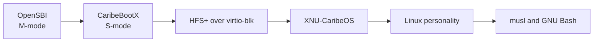

# CaribeOS Runtime for RV32IMACSU

[](https://github.com/h0nda1337/caribeos-runtime-rv32/actions/workflows/static-checks.yml?query=branch%3Amain)
[](https://github.com/h0nda1337/caribeos-runtime-rv32/actions/workflows/documentation-checks.yml?query=branch%3Amain)

Experimental XNU-based RV32IMACSU operating system with Sv32, SMP, a Linux
personality, real processes, and interactive GNU Bash.

CaribeOS is an independent experimental project. It is not affiliated with,
endorsed by, or supported by Apple Inc. It is not macOS, is not a complete
Darwin distribution, and is not production ready.

This repository owns the runtime side of the port: CaribeBootX, HFS+ boot
integration, the RV32 userland/initrd, musl and Bash build recipes, QEMU launch
targets, serial assertions, and process/SMP gates. The companion XNU repository
owns the kernel implementation.

The badges above report the public static and documentation checks. They do not
represent a full image rebuild or the preserved long-form boot suites.

The separate `develop/graphics-v0.1` branch adds native virtio GPU/input and
an authentic Syllable AppServer decorator running in userspace. See
[graphics commands and boundaries](docs/GRAPHICS_V0_1.md). This is not yet a
complete Syllable Desktop; Wayland and X11 remain unavailable.

`develop/syllable-native-v0.2` additionally verifies native IPC/shared areas,
genuine GNU C++ and Syllable String/Message data cores, counting semaphores,
and the [authentic FreeType RV32-musl dependency](docs/SYLLABLE_FONT_DEPENDENCY.md).
The [raw shared-task thread checkpoint](docs/SYLLABLE_NATIVE_THREADS.md) now
adds genuine CPU0 user threads, join/reaper, timer and same-task semaphore gates.
The optional [private futex backend](docs/SYLLABLE_PRIVATE_FUTEX.md) adds actual
scheduler WAIT/WAKE and cancellation gates without enabling pthread.
The original [Syllable Thread lifecycle](docs/SYLLABLE_NATIVE_THREAD_API.md)
now has a separate opt-in profile with native monotonic clock, worker sleep,
finite Locker timeouts and real cancellation/join. Its tests do not enable
worker allocation/stdio, GNU thread exceptions or a complete Looper.
The optional [original MessageQueue/native worker ports](docs/SYLLABLE_NATIVE_QUEUE.md)
profile adds the genuine intrusive queue, CPU0 typed-message contention and
actual port waits, finite deadlines, generation reuse and blocked cancellation.
That Queue profile still uses controller-only allocation; Looper is not replaced.
The separate [genuine musl worker heap](docs/SYLLABLE_NATIVE_HEAP.md) profile now
verifies concurrent mallocng, worker Message construction/decode/ReadPort and
protected allocator cancellation with real native VM and futex waits.
Worker-safe stdio, GNU thread exceptions and full AppServer/Desktop are still required; passing
these dependency gates does not mark the desktop complete.

## Required Boot Chain

```text
OpenSBI (M-mode) -> CaribeBootX (S-mode) -> XNU-CaribeOS (S-mode)
```



The supported QEMU path is `-bios default -kernel build/caribe_rv32.elf`.
The obsolete direct-kernel `-bios build/caribe_rv32.bin` path is unsupported.

CaribeBootX receives the OpenSBI DTB, initializes UART, Sv32 identity mappings,
minimal traps/timer state, and virtio-blk. It reads HFS+, honors a
`kernel=/kernel.elf` setting in `com.apple.Boot.plist` when present, otherwise
uses `/kernel.elf`, and transfers control to XNU-CaribeOS.

## Current Status

| Status | Capability |
|---|---|
| Implemented | QEMU `virt` RV32 boot through OpenSBI and CaribeBootX, virtio-blk, HFS+ kernel loading, DTB handoff |
| Implemented | Sv32 XNU boot, two-hart kernel SMP, per-hart state, IPI/timer, remote TLB coherence, dual-CPU kernel scheduling |
| Implemented | Task/thread-backed process model, fork/exec/exit/wait, per-process pmap/FDs, signals, `rt_sigreturn`, pipes and pipelines |
| Implemented | Blocking UART TTY, selected job control, musl 1.2.5 and interactive GNU Bash 5.3.5 |
| Experimental | Userspace on CPU1, long process stress, IOKit probes, dynamic ELF support |
| Partial | Linux syscall compatibility, POSIX semantics, drivers, IOKit service matching, filesystem surface |
| Not implemented | Production security, writable general filesystem, networking, broad hardware support, macOS compatibility |

The Linux personality maps selected Linux-compatible syscalls onto XNU. It
does not contain a Linux kernel.

The `develop/caribesecurity-v0.1` branch adds optional SecureSBI (modified
OpenSBI v1.9), functional CaribeSSBI discovery, and Ed25519/SHA-256 CatKey
verification inside CaribeBootX. Stock OpenSBI remains supported. QEMU remains
ORANGE even after signature verification: there is no authenticated hardware
root, protected signing key, or trusted attestation. See
[CaribeSecurity v0.1](docs/CARIBE_SECURITY.md).

## Quick Verification

From this directory in PowerShell:

```powershell
.\testproject.ps1 -Mode up -Seconds 45
.\testproject.ps1 -Mode gates -Seconds 50
.\testproject.ps1 -Mode interactive -Seconds 120
.\testproject.ps1 -Mode console
.\testproject.ps1 -Mode process-stability -Seconds 300
.\testproject.ps1 -Mode process-stress -Seconds 300 -StressRounds 10000
```

`testproject.ps1` finds the sibling XNU tree, rebuilds the current kernel, runs
the selected QEMU boots, and performs semantic assertions over serial output.
`interactive` is the automated Bash gate. `console` rebuilds the same boot
chain and leaves GNU Bash attached to the current terminal; quit QEMU with
`Ctrl+A`, then `X`.
See [TESTING.md](TESTING.md).

## Preserved Tranche 201 Kernel

- File: `xnu-caribeos-rv32-full-stage0.elf`
- Size: 945,004 bytes
- SHA-256: `c63fe4bfbaeaf674a4092c1c579cfe472fc433d2e89b4f55307484ed820e595e`

Generated ELF, initrd, HFS+, DTB, logs, third-party source archives, and build
trees are intentionally excluded from normal Git. They are preserved in the
local raw snapshot or packaged as private release assets.

## Documentation

- [BUILDING.md](BUILDING.md)
- [RUNNING_QEMU.md](RUNNING_QEMU.md)
- [TESTING.md](TESTING.md)
- [RESTORE.md](RESTORE.md)
- [BOOTFLOW_HFSPLUS.md](BOOTFLOW_HFSPLUS.md)
- [docs/BOOT_CHAIN.md](docs/BOOT_CHAIN.md)
- [docs/DEVELOPER_PREVIEW.md](docs/DEVELOPER_PREVIEW.md)
- [docs/TRANCHE_201_RELEASE_NOTES.md](docs/TRANCHE_201_RELEASE_NOTES.md)
- [docs/TRANCHE_201_EVIDENCE.md](docs/TRANCHE_201_EVIDENCE.md)
- [ROADMAP.md](ROADMAP.md), [SUPPORT.md](SUPPORT.md), and [SECURITY.md](SECURITY.md)
- [CONTRIBUTING.md](CONTRIBUTING.md) and [CODE_OF_CONDUCT.md](CODE_OF_CONDUCT.md)
- [docs/DEVELOPMENT_WITH_CODEX.md](docs/DEVELOPMENT_WITH_CODEX.md) and [CITATION.cff](CITATION.cff)
- [docs/SOURCE_TREE.md](docs/SOURCE_TREE.md)
- [docs/CARIBE_SECURITY.md](docs/CARIBE_SECURITY.md)
- [docs/CATKEY_V1.md](docs/CATKEY_V1.md)
- [docs/CARIBE_HYPERVISOR.md](docs/CARIBE_HYPERVISOR.md)
- [docs/CATKEY_PORTAL_CONTRACT.md](docs/CATKEY_PORTAL_CONTRACT.md)

The companion kernel source is
[h0nda1337/caribeos-xnu-rv32](https://github.com/h0nda1337/caribeos-xnu-rv32).

## License Status

Original CaribeOS runtime code carrying the project SPDX header is licensed
under BSD-2-Clause; see [LICENSE](LICENSE) and the exact allowlist in
[docs/RUNTIME_LICENSE_SCOPE.json](docs/RUNTIME_LICENSE_SCOPE.json). This grant
does not relicense XNU, GNU Bash, musl, OpenSBI, QEMU, generated material, or
other external components. See
[docs/PUBLIC_LICENSE_REVIEW.md](docs/PUBLIC_LICENSE_REVIEW.md),
[NOTICE.md](NOTICE.md), and [THIRD_PARTY.md](THIRD_PARTY.md).

The public-preview Release distributes
`caribeos-tranche-201-corresponding-source.zip` beside the Developer Preview.
See the [Tranche 201 release notes](docs/TRANCHE_201_RELEASE_NOTES.md) for the
curated asset set, exact source tags, and verification procedure.

When reporting a problem, include the selected mode, kernel SHA-256, tool
versions, complete serial log, CPU count, and whether UP or SMP failed. Never
include credentials or proprietary SDK material.
