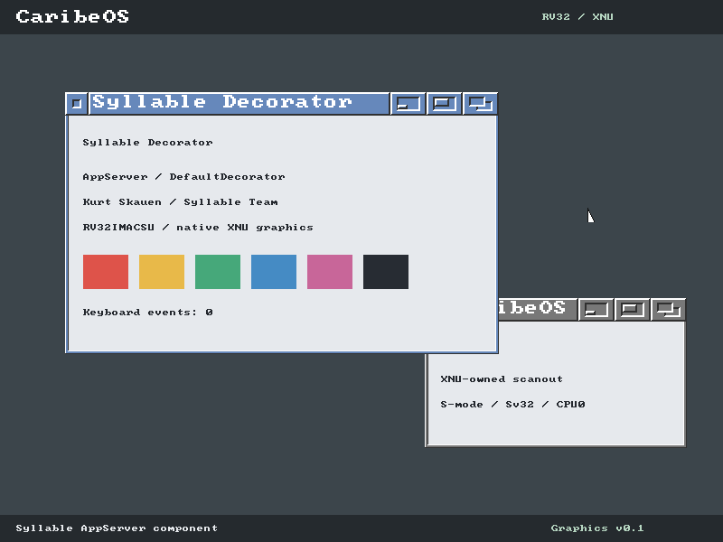
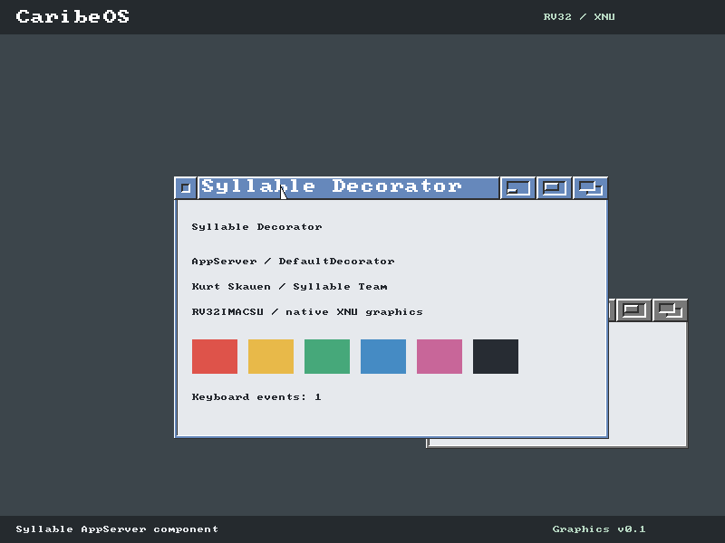

# Graphics v0.1 Evidence

Recorded on 2026-10-12 using QEMU 11.0.0, `virt`, 256 MiB, and native RV32
XNU. This is an authentic Syllable AppServer **decorator component**, not a
complete AppServer or Desktop. CBX does not draw these frames.

The five case directories contain separate gates A-E, the private-VM gate,
boot summaries, result JSON and five direct QEMU scanout captures:

- `01-syllable.png`: first independently executed userspace frame.
- `02-keyboard-focus.png`: title-bar pixels changed by a real Tab event.
- `03-mouse-drag.png`: the original decorator border moved by mouse input.
- `04-input-verified.png`: eleven Tab presses processed without event loss.
- `05-session-restart.png`: fresh process restores the initial window state.

The runner compares specific border/focus pixels, event sequences and guest
counters, then requires clean exits, a subsequent Bash command and PID1 reaping.
Every result identifies the tested kernel/runtime artifacts and captures by
SHA-256. Full serial output remains under `build/graphics-tests/` locally;
only compact evidence is committed. OpenSBI and SecureSBI are tested with
one and two harts. Graphics stays on CPU0, while SMP gates exercise CPU1.
The additional `opensbi-smp2-imacsu` case disables F, D, H and Zfa explicitly;
the firmware reports base ISA `rv32imac`. Default additional Z/S extensions
remain enabled; this does not assert an extension-minimal CPU configuration.

[syllable-sources.json](syllable-sources.json) identifies the four original and
adapted LGPL-2.0-only files. [Rebuild hashes](reproducible-artifacts.json) cover
the seven generated artifacts; rebuilding changed kernel/library/application
units reproduces these hashes. This is an incremental forced-rebuild check,
not a claim of a completely clean toolchain/bootstrap build.

[Security results](security-results.json) record signed boot and rejection
cases. The graphics matrix uses the explicit experimental ORANGE policy;
no hardware trust root or GREEN state is claimed.

## Final Regression Matrix

[regression-summary.json](regression-summary.json) identifies the final kernel
and scope. All automated cases use the same kernel SHA-256:

| Verification | Result |
|---|---|
| Native graphics/input gates A-E | 5/5 distinct firmware/CPU cases PASS |
| [Process gates](process-gates.txt) | 15/15 PASS |
| [Gate 15 SMP](process-gate15-smp.txt) | Full Bash/process/signals/pipes/TTY matrix PASS |
| [OpenSBI CPU1 stress](stress-opensbi.txt) | 10,000 lifecycles, exact resource baselines PASS |
| [SecureSBI CPU1 stress](stress-securesbi.txt) | 10,000 lifecycles, exact resource baselines PASS |
| Signed boot / rejection / enrollment clearing | 17/17 QEMU cases PASS |
| Catkey host tests | 14/14 PASS |
| Forced incremental artifact rebuild | 7/7 hashes identical |

[live-preview.json](live-preview.json) records an actual three-second SDL
session, closed normally. It is separate from the automated input matrix and
is not counted as an additional passing input test.

To repeat, use [the documented runners](../../GRAPHICS_V0_1.md).
Wayland, X11, Desktop, Dock, FileBrowser, shared buffers and AppServer IPC
remain unimplemented and are not represented by these screenshots.
