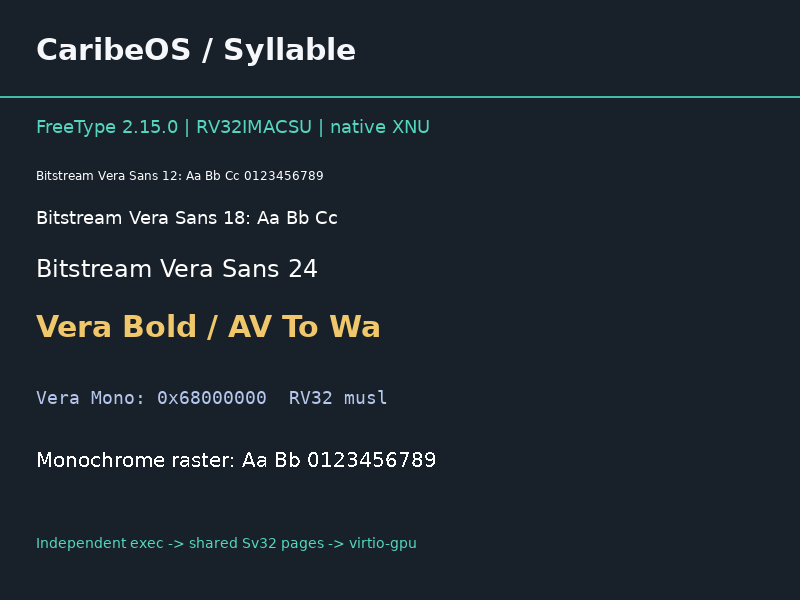

# Genuine FreeType Evidence

Recorded from actual QEMU runs on 2026-10-13, not generated guest fixtures.
All three retained matrices use RV32IMAC with F/D/H disabled and end with
Bash exit(0); SMP matrices also pass the real kernel scheduler gate F.

Each case contains separate FreeType A-D logs, the existing selected
C++/String/Message/IPC/area/semaphore gates, boot summary, result JSON and
seven real QMP captures. The font image is a dependency test rendered by
genuine FreeType from an independently executed process through native
shared Sv32 pages and virtio-gpu. It is not the Syllable Desktop/AppServer.

`sources.json` retains immutable official upstream pins, every original
FreeType blob hash and publisher-pinned Vera files. `rebuild.json` records
43 actually recompiled C units and ten byte-identical artifacts. The manifest
ties completed matrices to current artifacts. No ELF, archive, font binary,
disk image, private key or new Release asset is committed here.

The earlier v0.7 process regression remains separate because the exact kernel
is unchanged. Host unit tests/collector fixtures are explicitly host-only.
See [scope, commands and remaining dependencies](../../SYLLABLE_FONT_DEPENDENCY.md).
